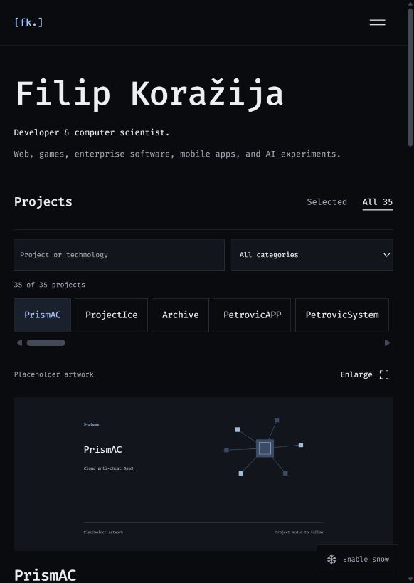

# Filip Koražija: Portfolio V2

A personal project workspace that retains V1's dark palette, Fira Code typography, restrained blue selection, and snowfall.

[View the live portfolio](https://portfolio-filipkorazijas-projects.vercel.app/)



## Run locally

```sh
npm install
npm run dev -- --hostname 127.0.0.1
```

Open http://127.0.0.1:3000.

## Validate

```sh
npm run typecheck
npm run build
```

## Add or update projects

Edit `src/components/project-data.ts`. Each project supplies its title, category, status, description, role, preview image, image label, background color, tags, optional engineering highlights, related work, gallery, and external links. Set featured: true to include it in Selected. Put images in `public/` and reference paths such as `/new-project/preview.png`.

Eight projects appear in Selected, and All contains the full 35-entry inventory. Search matches titles, descriptions, technologies, and related work; category filtering searches the entire collection. All projects are shown on a fresh page load, with the first project selected initially. Keep image labels accurate: source-code images and repository captures should not be called product screens.

## Interaction

Select a project to update the image inspector and description without scrolling or navigating. Arrow keys, Home, and End move through the project index. Thumbnails change the preview. The gallery supports previous/next, arrow keys, Escape, focus trapping, and focus return.

The mobile index becomes horizontally scrollable. Native scrolling and complete static content remain usable with reduced motion. Contact controls include direct email, copying the address, GitHub, and LinkedIn.

## Design records

`PRODUCT.md` records the supplied facts and constraints. `DESIGN.md` and `.impeccable/design.json` document the implemented system. Original project rasters retain their pixels and carry origin metadata referring to the original repository commit.

The redesign is developed on `redesign/v2`; `main` is the production branch. V1 remains available in Git history.

## Replacing placeholders

Twenty projects retain explicitly labeled artwork from `public/project-placeholders/`. Eleven projects now use 25 images supplied by Filip in `public/project-media/`, alongside the four projects with original repository imagery. The media manifest records source filenames and SHA-256 hashes; the supplied files are copied unchanged. Labels distinguish prototypes, development captures, and design boards. Both Petrovic boards were explicitly approved for publication by Filip. To replace a remaining placeholder, update image and imageLabel in the project record, set placeholder: false, and add optional gallery entries. No dates, delivery claims, scores, or demo URLs were invented.

## AI page

`/ai` presents Filip’s own perspective on AI-assisted development. The shared navigation links back to homepage sections from either route. The skills section distinguishes his strongest areas (Java, C#, and web development) from tools used on one or a few projects.

## Deploy on Vercel

The existing Vercel project `portfolio` is connected to `filipkorazija/Portfolio`; pushes to `main` automatically deploy to production. It uses the Next.js preset with root directory `./`. The portfolio needs no environment variables. Builds use `npm run build`. Fira Code is fetched through Next.js font optimization during the build; the deployed font is self-hosted.

For a direct deployment from this directory:

```sh
npx vercel login
npx vercel --prod
```
